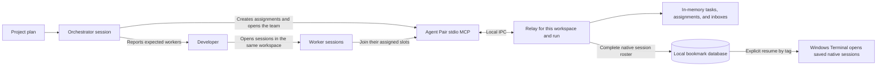
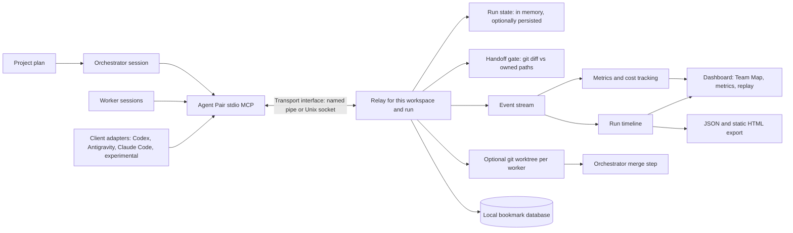
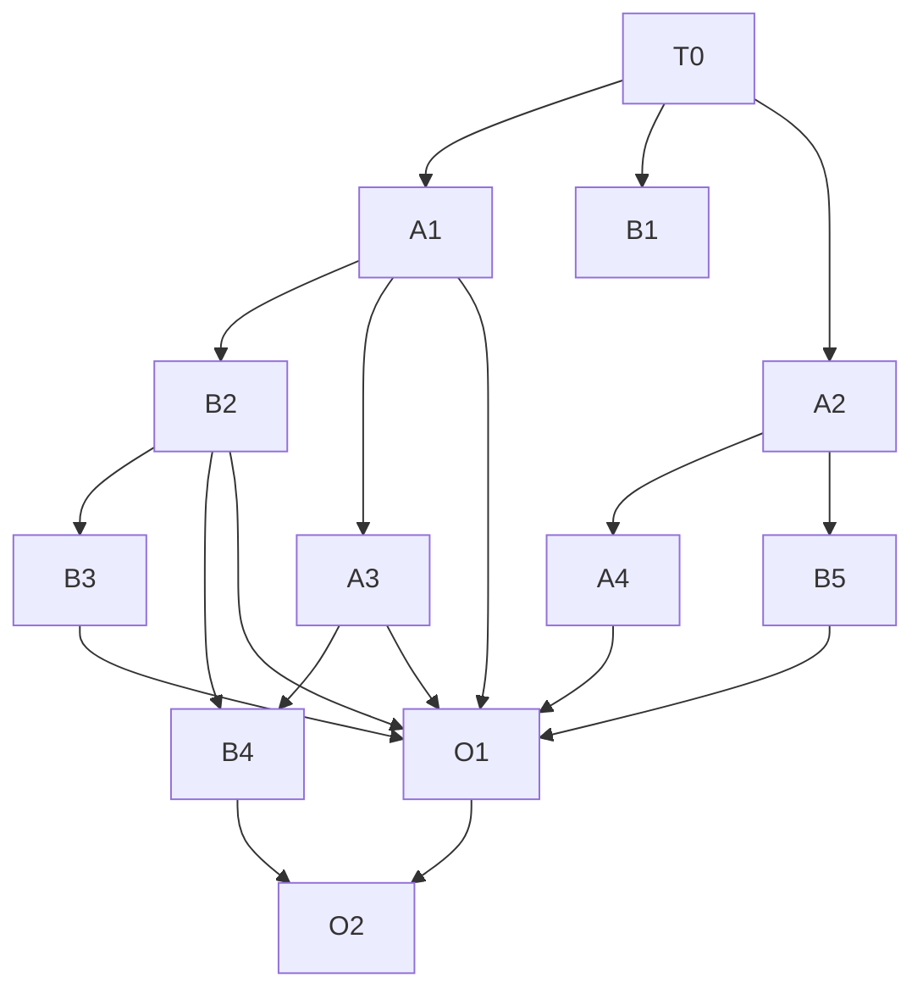

# Agent Pair implementation plan

Agent Pair connects active coding sessions in the same workspace. The orchestrator reads the project plan, divides the work, and takes an assignment of its own. Each worker joins its own slot. Codex, Google Antigravity, and Claude Code can fill any slot, including the orchestrator. A team can include multiple sessions from the same client.

> **Document status.** The execution below produced a v0.4 implementation in this checkout; portions are still uncommitted. The v0.3.1 sections are retained as historical context. The v0.4 architecture and verification tables describe implemented features and intended checks, subject to the limitations recorded in `docs/CASE_STUDY.md`: Unix runtime tests were skipped on Windows, Gemini relay support is deferred, worktree reassignment requires manual recovery, and shared-checkout ownership checks cannot attribute changes. Actual installed client configuration has not been updated. No live-agent benchmark results were collected.

## Architecture (v0.3.1 baseline)

Each fresh run starts empty in the canonical repository or worktree. Workers claim open slots for their client profile. The relay scopes handles to the member, client profile, and run. Messages go to a specific member. The relay expires inactive runs after 30 minutes and discards their task and message state. The legacy two-agent flow continues to match live Codex and Antigravity requests in the same workspace. [Node.js IPC](https://nodejs.org/api/net.html#ipc-support)

## Architecture (v0.4 implementation and limitations)

Changes from v0.3.1:

- **Transport.** The relay connection sits behind a `Transport` interface. Windows keeps named pipes. macOS and Linux use Unix domain sockets with `0600` permissions.
- **Enforcement.** Handoffs are checked against the task's owned paths using `git diff`, so ownership no longer depends on agents behaving.
- **Isolation.** An optional `--isolation=worktree` mode gives each worker its own worktree and branch, with an orchestrator-driven merge.
- **Recovery.** Members send heartbeats, stalled tasks are detected, and run state can be persisted so a relay restart restores an active run.
- **Observability.** Relay events feed metrics (time, messages, rejections, optional tokens and cost) and a replayable timeline.
- **Extensibility.** Client support moves behind a `ClientAdapter` interface.

## Project plan and ownership (v0.3.1 baseline)

Use the template from `agent-pair init` for new projects. Each assignment has a task ID, member ID, client profile, deliverable, owned paths, acceptance checks, and optional dependency task IDs. The member ID `orchestrator` is reserved for the lead. Each shared path has one owner. The relay rejects overlapping file or directory assignments across owners, and agents follow those boundaries in their normal editors.

Workers can start independent tasks in parallel. A dependent task becomes eligible after the orchestrator accepts its prerequisites. The task owner submits a handoff summary and check results. The orchestrator accepts the handoff or requests a revision with a note. The orchestrator works on its own assignments and runs integration checks spanning the team's work.

**(v0.4)** On handoff, the relay computes changed files against the task's base commit. Strict mode rejects out-of-bounds files; `warn` reports them and `off` disables the gate. Violations emit an `ownership.violation` event. In a shared checkout this includes pre-existing and other workers' changes and cannot establish authorship. Path glob syntax is rejected rather than expanded.

## Commands and tools

| CLI command | Behavior |
| --- | --- |
| `agent-pair setup --dry-run --profiles codex,antigravity,claude` | Preview configuration for the selected clients. |
| `agent-pair setup --apply --profiles codex,antigravity,claude` | Install the shared skill, MCP server registration, and session-start hook. |
| `agent-pair doctor --profiles codex,antigravity,claude` | Check client binaries and run an MCP round trip in a temporary workspace. |
| `agent-pair init` | Create a starter plan in the current workspace if one does not exist. |
| `agent-pair resume <tag>` | Reopen the bookmarked native sessions in their saved workspace. |
| `agent-pair close <run-id>` | Close a live run and discard its in-memory state. |
| `agent-pair replay <run-id>` | Open the dashboard replay for a recorded run. |
| `agent-pair export <run-id>` | Export a run as self-contained JSON or a static HTML report. |
| `agent-pair bench` | Run the team-versus-solo benchmark harness. |
| `team-start --enforce=strict\|warn\|off` | Set ownership enforcement at handoff. |
| `team-start --isolation=shared\|worktree` | Choose a shared workspace or one git worktree per worker. |

| MCP tool | Behavior |
| --- | --- |
| `team_setup` | Read the pending dashboard setup for the current workspace. |
| `team_start` | Create a fresh team with the selected worker count, profiles, and assignments. |
| `team_join` | Claim an available slot for your client in the same workspace and retrieve its assignments. |
| `team_update` | Start, block, or hand off owned work, or accept or request revisions as orchestrator. |
| `pair_send`, `pair_inbox`, `pair_ack` | Send directed messages, read unread messages, and acknowledge receipt. |
| `pair_status` | Inspect the roster, progress, and handoffs for the current run. |
| `pair_disconnect` | Leave a worker slot, or close the whole run as orchestrator. |
| `pair_connect` | Start a fresh two-agent Codex and Antigravity pairing. |

Omit `--profiles` to select Codex and Antigravity. The Claude adapter uses user-scoped MCP configuration and a `SessionStart` hook. [Claude Code MCP](https://code.claude.com/docs/en/mcp) · [Claude Code hooks](https://code.claude.com/docs/en/hooks)

## Project bookmarks (v0.3.1 baseline)

Once all members provide native session IDs, store the workspace path, member IDs, client profiles, and native session IDs under a stable four-character tag. Preserve the previous bookmark until a complete roster is available. Migrate existing two-agent bookmarks with their original tags.

The explicit `resume` command opens one Windows Terminal tab per member using the appropriate native resume command. The clients load their own histories. A new invocation of the collaboration workflow starts a fresh run. [Claude Code CLI](https://code.claude.com/docs/en/cli-reference) · [Windows Terminal CLI](https://learn.microsoft.com/en-us/windows/terminal/command-line-arguments)

**(v0.4)** On macOS and Linux, `resume` prints native resume commands and can open tmux panes with `--tmux`. Unix runtime and tmux were not verified during the Windows run.

## Verification

| Scope | Checks |
| --- | --- |
| Workspace and team isolation | Reject mismatched workspaces, and client profiles. Confirm empty inboxes and fresh task state on a new run. |
| Parallel assignments | Connect four independent MCP processes, including two Claude Code profiles. Start independent tasks concurrently. Reject file overlaps, circular dependencies, and unauthorized updates. |
| Messaging and lifecycle | Verify directed delivery, acknowledgments, retries, worker disconnects, and run expiry. |
| Setup | Merge client registrations and hooks into temporary settings and verify repeatability. |
| Resume | Verify exact native session IDs, one launcher tab per member, and compatibility with existing four-character tags. |
| Native smoke test | Launch the chosen clients, verify tool discovery, join a fresh team, hand off a task, then reopen the recorded sessions by tag. |
| Ownership gate | Tests cover in-bounds and out-of-bounds changes, renames, deletes, and rejected glob syntax. Shared-checkout attribution remains limited. |
| Transport | Windows conformance passed; Unix socket tests require a native Unix host. |
| Worktrees | Tests cover disjoint merges, conflicts, and clean worktree cleanup. Dirty or unmerged work is preserved. |
| Recovery | Tests kill and restart the broker and flag a silent worker as stalled. Heartbeats require client scheduling. |
| Metrics and replay | Fixture aggregation, replay final states, and offline export are tested. |
| Adapters | Conformance tests cover built-in adapters; experimental Gemini relay setup is disabled. |

---

# v0.4 execution plan

Goal: upgrade Agent Pair from a working Windows-only prototype into a measured, cross-platform, enforceable multi-agent orchestration tool that demonstrates AI-native engineering: evals, safety, recoverability, observability.

This plan is executed by Agent Pair on Agent Pair (dogfooding). The sections above are the architecture reference. Everything below is the assignment list for the team.

## Team

| Member | Client profile | Role |
|---|---|---|
| orchestrator | codex | Discovery, integration, CLI wiring, final verification |
| worker-a | codex | Core runtime: enforcement, worktrees, transport, recovery |
| worker-b | antigravity | Product surface: dashboard, metrics, benchmark, docs, CI |

Client profiles can be swapped. Keep three distinct owners.

## Global rules

1. Work only in this repository checkout. Run the tool with `node dist/cli.js`, never the globally installed `agent-pair`. Do not run `npm publish`.
2. Edit only paths you own (see Owned paths). If you need a change elsewhere, send a request to the owner through the relay.
3. Commit after each task: `git commit -m "<task-id>: 
"`. Never force push and never rewrite history.
4. A task is done only when its acceptance checks pass. The handoff message must include files changed, commands run, output summary, and known gaps.
5. Existing tests must keep passing. Add tests for every new behavior.
6. Do not weaken existing safety checks to make a task pass. If blocked, report the blocker to the orchestrator.
7. Do not fabricate results, metrics, or benchmark numbers anywhere.
8. The orchestrator verifies the real repository layout in T0 and corrects every path below if it differs.

## Owned paths (reconciled in T0)

The existing implementation is flat under `src/`, with one existing test file, `test/agent-pair.test.mjs`. New directories listed below may be created by their owner. Owners coordinate cross-boundary changes through the relay.

- **orchestrator:** `plan.md`, `package.json`, `package-lock.json`, `src/cli.ts`, `CHANGELOG.md`, `docs/CASE_STUDY.md`
- **worker-a (Codex):** `src/relay.ts`, `src/team.ts`, `src/types.ts`, `src/ipc.ts`, `src/workspace.ts`, `src/resume.ts`, `src/bookmarks.ts`, `src/server.ts`, `src/transport/`, `src/core/`, `src/git/`, `test/relay/`, `test/transport/`, `test/git/`, `test/agent-pair.test.mjs`
- **worker-b (Antigravity):** `src/dashboard.ts`, `src/metrics/`, `src/adapters/`, `src/setup.ts`, `src/capture.ts`, `src/doctor.ts`, `bench/`, `README.md`, `LICENSE`, `.github/`, `docs/BASELINE.md`, `docs/WRITING_AN_ADAPTER.md`, `test/dashboard/`, `test/metrics/`, `test/adapters/`

## Tasks

### T0: Discovery and baseline
- Owner: orchestrator | Client: codex
- Depends on: none
- Do: map the real repository structure, build, run the existing test suite, and record the baseline (test count, pass or fail, build time). Reconcile Owned paths above with reality and update this file. Hand off the baseline text so worker-b can commit it as `docs/BASELINE.md`.
- Acceptance: `npm ci && npm run build && npm test` pass. Owned paths match the real tree with no overlaps.

### A1: Real ownership enforcement at handoff
- Owner: worker-a | Client: antigravity
- Depends on: T0
- Do: implement the handoff gate described under "Project plan and ownership (planned v0.4)". Compute changed files with `git diff --name-only` against the task's base commit, reject out-of-bounds handoffs with a clear error, support `--enforce=strict|warn|off` (default strict), and emit an `ownership.violation` event.
- Acceptance: unit tests for in-bounds, out-of-bounds, renamed, deleted, and glob edge cases. An integration test where a worker edits an unowned file and the handoff is rejected. `npm test` passes.

### B1: Repo hygiene and first impression
- Owner: worker-b | Client: claude
- Depends on: T0
- Do: add an MIT `LICENSE`. Add GitHub Actions CI that builds and tests on Windows, macOS, and Ubuntu (Node 20 and 24 if feasible, otherwise justify the Node 24 minimum in the README). List the `package.json` fields to add (`repository`, `bugs`, `homepage`, `keywords`, `license`) for the orchestrator to apply. Restructure the README with a one-line pitch at the top, a demo placeholder, a Limitations section, and a Threat Model section that is honest about gaps that remain until A1 lands.
- Acceptance: the CI workflow is valid YAML. The README has pitch, quickstart, limitations, and threat model. The requested `package.json` changes are listed in the handoff.

### A2: Cross-platform transport and resume launcher
- Owner: worker-a | Client: antigravity
- Depends on: T0
- Do: put the relay connection behind a `Transport` interface. Keep the Windows named-pipe implementation and add a Unix domain socket implementation for macOS and Linux, chosen by platform. Make the data directory cross-platform (`%LOCALAPPDATA%` on Windows, XDG or `~/.local/share` elsewhere, still overridable with `AGENT_PAIR_DATA_DIR`). Secure the socket with `0600` permissions and the local relay key. Add the non-Windows `resume` behavior described under "Project bookmarks (planned v0.4)".
- Acceptance: a transport conformance suite runs against both implementations (skip the non-native one with a clear reason). No Windows-only API remains outside the Windows transport file. The build passes on the current OS.

### B2: Metrics and cost tracking
- Owner: worker-b | Client: claude
- Depends on: A1
- Do: build a metrics module that consumes relay events (task start, handoff, rejection, ownership violation, message counts, wall time per task) and optional token or cost reports submitted by agents. Persist per-run metrics as JSON. Show per-agent and per-task time, message counts, rejections, and (when reported) tokens and cost in the dashboard.
- Acceptance: unit tests on aggregation with fixture events. The dashboard renders metrics for a fixture run. Missing cost data degrades gracefully.

### A3: Git worktree isolation per worker
- Owner: worker-a | Client: antigravity
- Depends on: A1
- Do: implement `--isolation=worktree`. On team start, create one worktree and branch per worker (`agent-pair/<run>/<member>`). Ownership checks diff against the worker's branch. Provide a merge step the orchestrator invokes after review, with conflict reporting. Clean up worktrees on finish or abort. The default stays a shared workspace.
- Acceptance: an integration test with two workers editing different files in separate worktrees and merging cleanly. A test where a conflict is reported and not swallowed. Cleanup leaves no stray worktrees or branches.

### A4: Crash recovery and persistence
- Owner: worker-a | Client: antigravity
- Depends on: A2
- Do: add member heartbeats and a configurable stall timeout that marks a silent worker's task `stalled` so the orchestrator can reassign it. Persist run state (tasks, ownership, dependencies, message log) to SQLite or an append-only JSONL file in the data dir so a relay restart restores an active run. Keep in-memory as the default when persistence is off.
- Acceptance: a test that kills the relay mid-run and restores state. A test that flags a silent worker as stalled. No regression in existing tests.

### B3: Run replay and export
- Owner: worker-b | Client: claude
- Depends on: B2
- Do: record a timeline for every run (events, messages, handoffs). Add a dashboard Replay view with play, pause, and scrub over the timeline and Team Map. Add export to a single self-contained JSON file and a shareable static HTML report that needs no server.
- Acceptance: replaying a fixture run reproduces the final task states. The static HTML export opens offline. Tests cover timeline ordering.

### B4: Benchmark harness (team versus solo)
- Owner: worker-b | Client: claude
- Depends on: B2, A3
- Do: create `bench/` with 3 to 5 small, self-contained tasks (for example: add a CLI flag with tests, build a small REST endpoint, refactor a module, fix seeded bugs), each with hidden acceptance tests. Provide a runner that records, per task and per mode (solo versus team): wall time, test pass rate, merge conflicts, rejected handoffs, and tokens or cost where available. Write results to `bench/results/*.json` and provide a markdown summary generator. The harness must be runnable by a human with real agent CLIs.
- Acceptance: `bench/README.md` explains how to run it. The runner works in `--dry-run` with stub agents. The summary generator produces a table from fixture results. No fabricated numbers anywhere.

### B5: Adapter interface for more clients
- Owner: worker-b | Client: claude
- Depends on: A2
- Do: define a `ClientAdapter` interface (setup, doctor, launch, resume, session-ID discovery) and refactor Codex, Antigravity, and Claude Code support behind it. Add an example adapter for one more client (for example Gemini CLI) behind a clearly marked experimental flag. Write `docs/WRITING_AN_ADAPTER.md`.
- Acceptance: existing client behavior is unchanged and tests pass. An adapter conformance suite exists. The docs include a worked example.

### O1: CLI wiring and integration
- Owner: orchestrator | Client: codex
- Depends on: A1, A3, A4, B2, B3, B5
- Do: wire the new features into `src/cli.ts` (`--enforce`, `--isolation`, `replay`, `export`, `bench`, adapter selection, recovery flags). Apply the `package.json` changes requested by worker-b. Bump the version to 0.4.0 and update `CHANGELOG.md`. Resolve cross-owner requests and run the full integration check.
- Acceptance: `npm ci && npm run build && npm test` pass. Every new command appears in `--help`. `node dist/cli.js doctor` passes.

### O2: Case study, document reconciliation, final verification
- Owner: orchestrator | Client: codex
- Depends on: O1, B4
- Do: write `docs/CASE_STUDY.md` covering the problem, architecture (with a Mermaid diagram), design tradeoffs (in-memory versus persisted state, honor system versus diff enforcement, shared workspace versus worktrees, MCP and relay choices), what failed during this very run (use real logs and handoffs), and what is still unsafe. Include a "Built by itself" section summarizing how this plan was executed, with real metrics from B2 and a candid assessment. Then reconcile this file: move every landed **(planned v0.4)** item into the **(current)** descriptions, remove items that did not land or mark them as deferred, and update the version references.
- Acceptance: every claim in the case study is backed by files or logs in the repo. This file no longer describes unbuilt work as current. The final report lists every task, its status, and anything left undone.

## Dependency overview

## Final report (orchestrator to the human)

1. A table of tasks with status, commit hashes, and test results.
2. Failures, rejected handoffs, ownership violations, and stalls observed during this run.
3. A metrics summary for the run (time, messages, tokens or cost if available).
4. Open issues and recommended next steps.
