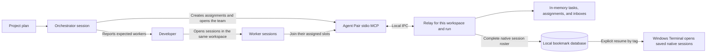

# Agent Pair implementation plan

Agent Pair connects active coding sessions in the same workspace. The orchestrator reads the project plan, divides the work, and takes an assignment of its own. Each worker joins its own slot. Codex, Google Antigravity, and Claude Code can fill any slot, including the orchestrator. A team can include multiple sessions from the same client.

## Architecture

Each fresh run starts empty in the canonical repository or worktree. Workers claim open slots for their client profile. The relay scopes handles to the member, client profile, and run. Messages go to a specific member. The relay expires inactive runs after 30 minutes and discards their task and message state. The legacy two-agent flow continues to match live Codex and Antigravity requests in the same workspace. [Node.js IPC](https://nodejs.org/api/net.html#ipc-support)

## Project plan and ownership

Use the template from `agent-pair init` for new projects. Each assignment has a task ID, member ID, client profile, deliverable, owned paths, acceptance checks, and optional dependency task IDs. The member ID `orchestrator` is reserved for the lead. Each shared path has one owner. The relay rejects overlapping file or directory assignments across owners, and agents follow those boundaries in their normal editors.

Workers can start independent tasks in parallel. A dependent task becomes eligible after the orchestrator accepts its prerequisites. The task owner submits a handoff summary and check results. The orchestrator accepts the handoff or requests a revision with a note. The orchestrator works on its own assignments and runs integration checks spanning the team’s work.

## Commands and tools

| CLI command | Behavior |
| --- | --- |
| `agent-pair setup --dry-run --profiles codex,antigravity,claude` | Preview configuration for the selected clients. |
| `agent-pair setup --apply --profiles codex,antigravity,claude` | Install the shared skill, MCP server registration, and session-start hook. |
| `agent-pair doctor --profiles codex,antigravity,claude` | Check client binaries and run an MCP round trip in a temporary workspace. |
| `agent-pair init` | Create a starter plan in the current workspace if one does not exist. |
| `agent-pair resume <tag>` | Reopen the bookmarked native sessions in their saved workspace. |
| `agent-pair close <run-id>` | Close a live run and discard its in-memory state. |

| MCP tool | Behavior |
| --- | --- |
| `team_setup` | Read the pending dashboard setup for the current workspace. |
| `team_start` | Create a fresh team with the selected worker count, profiles, and assignments. |
| `team_join` | Claim an available slot for your client in the same workspace and retrieve its assignments. |
| `team_update` | Start, block, or hand off owned work, or accept or request revisions as orchestrator. |
| `pair_send`, `pair_inbox`, `pair_ack` | Send directed messages, read unread messages, and acknowledge receipt. |
| `pair_status` | Inspect the roster, progress, and handoffs for the current run. |
| `pair_disconnect` | Leave a worker slot, or close the whole run as orchestrator. |
| `pair_connect` | Start a fresh two-agent Codex and Antigravity pairing. |

Omit `--profiles` to select Codex and Antigravity. The Claude adapter uses user-scoped MCP configuration and a `SessionStart` hook. [Claude Code MCP](https://code.claude.com/docs/en/mcp) · [Claude Code hooks](https://code.claude.com/docs/en/hooks)

## Project bookmarks

Once all members provide native session IDs, store the workspace path, member IDs, client profiles, and native session IDs under a stable four-character tag. Preserve the previous bookmark until a complete roster is available. Migrate existing two-agent bookmarks with their original tags.

The explicit `resume` command opens one Windows Terminal tab per member using the appropriate native resume command. The clients load their own histories. A new invocation of the collaboration workflow starts a fresh run. [Claude Code CLI](https://code.claude.com/docs/en/cli-reference) · [Windows Terminal CLI](https://learn.microsoft.com/en-us/windows/terminal/command-line-arguments)

## Verification

| Scope | Checks |
| --- | --- |
| Workspace and team isolation | Reject mismatched workspaces, and client profiles. Confirm empty inboxes and fresh task state on a new run. |
| Parallel assignments | Connect four independent MCP processes, including two Claude Code profiles. Start independent tasks concurrently. Reject file overlaps, circular dependencies, and unauthorized updates. |
| Messaging and lifecycle | Verify directed delivery, acknowledgments, retries, worker disconnects, and run expiry. |
| Setup | Merge client registrations and hooks into temporary settings and verify repeatability. |
| Resume | Verify exact native session IDs, one launcher tab per member, and compatibility with existing four-character tags. |
| Native smoke test | Launch the chosen clients, verify tool discovery, join a fresh team, hand off a task, then reopen the recorded sessions by tag. |
