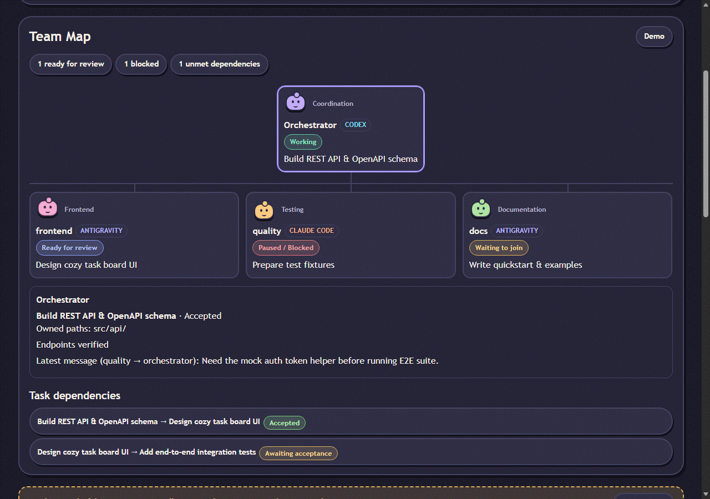

# Agent Pair

[](https://github.com/tnmy57/agent-pair/actions/workflows/ci.yml) [](https://www.npmjs.com/package/@tnmy57/agent-pair) [](LICENSE)

Coordinate multiple Codex, Google Antigravity, and Claude Code sessions in one workspace with explicit task ownership, dependency gating, directed messaging, and a live local dashboard.



The recording shows the dashboard's built-in demo data, not a live run. [GitHub repository](https://github.com/tnmy57/agent-pair) · [Architecture and case study](docs/CASE_STUDY.md)

## Quickstart

### Prerequisites and why Node.js 24+ is required

- **Node.js 24 or later** (`"engines": { "node": ">=24" }`). Node 20 is not supported because Agent Pair relies on Node's built-in `node:sqlite` (`DatabaseSync`) for zero-native-dependency session bookmarks and `URL.parse()` in the local dashboard HTTP server—neither API exists in Node 20.
- The native coding CLIs you plan to coordinate (`codex`, `agy`, and/or `claude`).
- Windows Terminal (`wt.exe`) on Windows if you use `agent-pair resume <tag>`.

### Install and configure clients

```powershell
npm.cmd install -g '@tnmy57/agent-pair'
agent-pair.cmd setup --dry-run --profiles codex,antigravity,claude
agent-pair.cmd setup --apply --profiles codex,antigravity,claude
agent-pair.cmd doctor --profiles codex,antigravity,claude
```

Choose installed clients with `--profiles` (default: `codex,antigravity`). Setup installs the shared skill, registers the stdio MCP server, and configures a `SessionStart` hook for each selected client while preserving existing entries and backing up modified files. Open fresh client sessions after setup and approve the session-start hook if prompted for automatic resume bookmarks (coordination still works without hook metadata).

### Coordinate a team

1. Run `agent-pair init` in a repository to generate a starter `plan.md` with task IDs, owners, client profiles, owned paths, dependencies, and acceptance checks.
2. Give one fresh session the orchestrator prompt:

> Use Agent Pair as the orchestrator to implement this workspace’s `plan.md`. Assign yourself a workstream and divide the rest among workers with clear file ownership, dependencies, and acceptance checks. Ask me how many workers to expect and which clients I want to use. Start the team, tell me when it is waiting, and work on your assignments while the workers work on theirs. Review their handoffs and run the project’s integration checks.

3. Open the requested worker sessions in the same workspace and give each the same worker prompt:

> Use the Agent Pair skill to join the team waiting in this workspace. Follow your assigned tasks and file boundaries, and report blockers and handoffs to the orchestrator.

The relay rejects overlapping file or directory assignments across owners at team startup and prevents dependent tasks from starting until their prerequisites are accepted by the orchestrator. Up to 64 tasks and 64 sessions with distinct owners are supported per run.

### Live browser dashboard

When a team starts, Agent Pair launches a token-gated local browser dashboard showing live agent state, **Team Map** dependencies, task progress, messages, and the four-character resume tag.

- Run `agent-pair dashboard` to open it manually, or `agent-pair dashboard --no-open` to print its URL.
- Set `AGENT_PAIR_DASHBOARD=0` in the orchestrator's environment to disable automatic opening.
- Use **Set up a team** in the dashboard to configure a workspace folder, lead client, and worker counts per client (pending setups expire after 30 minutes).
- Use **Preview Team Map Demo** to inspect the Team Map before starting a live run.

### Troubleshooting team connections

All sessions in a team need the same Agent Pair installation and `AGENT_PAIR_DATA_DIR`. After updating or rebuilding Agent Pair, restart the client sessions and their MCP servers: an already running MCP server continues to use the code it loaded at startup. A dashboard from another relay or version will not share its pending setups or teams.

On Windows, a relay started inside a restricted sandbox can create a named pipe that other clients cannot access. If a join fails with `EPERM` or access denied, close the affected team, then start the dashboard from a normal terminal using `node dist/cli.js dashboard --no-open` in a source checkout (or `agent-pair dashboard --no-open` for an installed package). Open the printed URL, start fresh client sessions, and use the same workspace and data directory. `agent-pair doctor` checks whether client registrations are up to date. Do not change sandbox permissions just to silence the error.

### Pair Codex and Antigravity (two-agent mode)

Open the same folder in fresh Codex and Antigravity sessions and give both the same prompt:

> Use Agent Pair to connect and work through this project's `plan.md`.

The relay matches both live requests by workspace and opens a fresh inbox. Closing a pairing discards its messages; inactive pairings expire after 30 minutes.

### Reopen native sessions

When every member supplies a native session ID, Agent Pair saves a four-character project tag (`agent-pair resume <tag>`) mapping the workspace, member IDs, client profiles, and native session IDs. Coordination messages are never stored in the bookmark database.

```powershell
agent-pair resume 6G7D --dry-run
agent-pair resume 6G7D
```

On Windows, the launcher opens one Windows Terminal tab per member using `codex resume`, `agy --conversation`, or `claude --resume`.

## Local data and development

- **Data directory:** `%LOCALAPPDATA%\AgentPair` on Windows (`$XDG_DATA_HOME/agent-pair` or `~/.local/share/agent-pair` on Unix), overridable via `AGENT_PAIR_DATA_DIR`. Stores `relay.key` and `bookmarks.sqlite`.
- **Relay lifecycle:** Starts on demand and exits after becoming idle.

```powershell
npm.cmd ci
npm.cmd run build
npm.cmd test
npm.cmd pack
node dist/cli.js --help
```

## Architecture and verification

Each agent session runs a stdio MCP server (`agent-pair serve --profile <client>`) that communicates with a shared local relay over local IPC. The relay tracks run rosters, task state transitions, and directed messages, and serves SSE snapshots to the local dashboard.

See the [case study](docs/CASE_STUDY.md) for the problem, architecture, design choices, and failures encountered, and [PLAN.md](PLAN.md) for the execution plan and verification matrix.

## Limitations and threat model

- **Ownership checks have limits:** Strict mode compares Git changes to owned paths. In a shared checkout it includes pre-existing and other workers' changes and cannot identify who made them. Ignored files are not covered; glob paths are rejected.
- **Shared working tree by default:** Optional worktree isolation exists, but dirty or unmerged worktrees require manual recovery; they are not forcibly discarded.
- **State and recovery:** Coordination is in memory by default and active runs expire after 30 minutes of inactivity. Persistence and stall detection are optional; clients must send heartbeats for stall detection to be meaningful.
- **Platform maturity:** Primary verification so far has been on Windows. Unix transport and tmux support need native verification, and restrictive Windows sandboxes can prevent clients from accessing a relay pipe.
- **No automatic token/cost capture:** Agents or wrappers must report usage; absent data is shown as unreported.
- **Node.js 24+ requirement:** Older Node LTS releases (including Node 20) are unsupported because `node:sqlite` and `URL.parse` are used directly.

### Threat model

Agent Pair is designed for **single-user local developer workstations**, not multi-tenant or untrusted network hosts.

### What is protected today

- **Local-only relay transport and authentication:** The relay listens on a local IPC endpoint (Windows named pipe / local Unix socket) and requires a 256-bit random secret stored in `relay.key` (`0600` file mode on Unix) on every request, checked with constant-time comparison (`timingSafeEqual`).
- **Loopback-only, token-gated dashboard:** The HTTP dashboard binds strictly to `127.0.0.1` with a fresh 128-bit random URL token per relay start, strict `Content-Security-Policy` with per-response script nonces, `Referrer-Policy: no-referrer`, and `Origin` header validation on mutating setup/picker routes.
- **Scoped session handles:** Each connected member receives a random 256-bit handle scoped to its run, member ID, and client profile; cross-session message reads, acknowledgments, and unauthorized task transitions are rejected.
- **Workspace-relative path validation:** Task path declarations reject absolute paths, `..` traversal, and invalid control characters.
- **Local data:** Bookmarks store workspace paths and native session IDs. If enabled, run snapshots can include handles, task notes, and messages; metrics and timeline recordings also contain run data. Protect the local data directory accordingly.

### Known gaps and residual risks

- **File boundaries are not a sandbox:** A buggy, prompt-injected, or non-compliant agent retains its native client permissions. Diff checks happen at handoff and cannot prevent edits, cover ignored files, or reliably attribute changes in a shared checkout.
- **Same-user local privilege boundary:** Any local process running as the same OS user that can read `relay.key` in the Agent Pair data directory can authenticate to the local relay, inspect active runs, or send/close runs.
- **Dashboard capability URL exposure:** The dashboard token lives in the URL path (`/d/<token>/`). Anyone with access to your screen, browser history, or local command output displaying `agent-pair dashboard` can view active runs and create/cancel pending setups until the relay restarts.
- **Native agent execution trust:** Agent Pair does not sandbox the underlying coding agents (Codex, Antigravity, Claude Code). Each agent retains whatever filesystem, shell, and network permissions its native client grants.
- **Hook execution on session start:** Installed `SessionStart` hooks execute local Node commands configured by `agent-pair setup`; keep the package installation path writable only by trusted local users.

## License

MIT — see [LICENSE](LICENSE).
