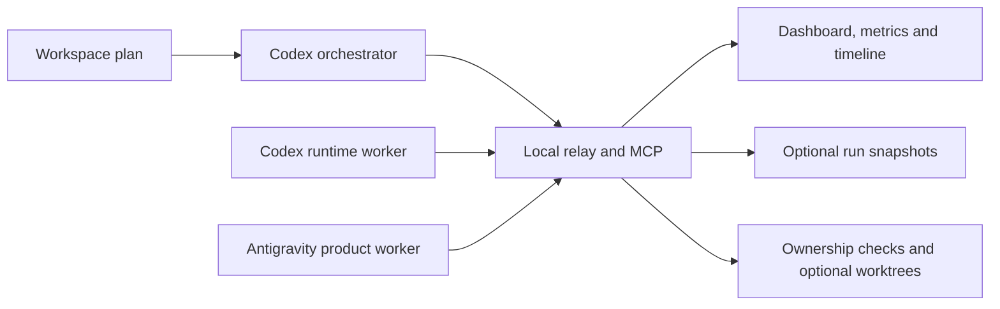

# Agent Pair v0.4 case study

Agent Pair addresses a practical coordination problem: independent coding sessions can overwrite each other's work, miss dependencies, and lose track of handoffs. A local relay gives an orchestrator and workers a shared roster, file boundaries, task states, and directed messages while each client keeps its own conversation.

For this case study the project coordinated work on itself, with a Codex orchestrator, a Codex runtime worker, and an Antigravity product worker. The resume tag was `CRYL`. The team worked in a shared checkout with pre-existing uncommitted changes.

## Tradeoffs

- **In-memory state by default:** A short-lived local run needs little configuration and avoids writing task messages and session handles to disk by default. The cost is that a relay restart or expiry loses that state. Optional snapshots restore teams after a restart but contain sensitive run data and require protection of the local data directory. Corrupt state fails startup rather than being silently discarded.
- **Named pipes and Unix sockets:** A Windows named pipe keeps local relay traffic off a network port and fits the original Windows-first target. Unix domain sockets provide a corresponding local transport on macOS and Linux. Local IPC still needs an authentication key and platform-specific permission handling: on Windows, a relay started inside a restricted sandbox can be inaccessible to other clients.
- **MCP:** A shared MCP interface lets supported agents invoke the same coordination operations from their native clients, rather than requiring a separate custom client integration for every task. That choice depends on each client's MCP configuration and approval behavior; after an update, running clients may keep an older server and connect to a different relay version.
- Handoff checks compare Git changes with declared paths. Strict mode can reject changes from other workers or pre-existing edits in a shared checkout; it does not establish authorship. Glob paths are rejected. Worktrees provide stronger separation, but dirty or unmerged worktrees are preserved for manual recovery, and reassignment of isolated work is not automatic.
- Stall detection requires clients to schedule heartbeat calls. Without them a working but quiet agent can be marked stalled.
- Relay authentication and the token-gated loopback dashboard reduce accidental access, but same-user processes with access to the relay key retain substantial authority. Agent Pair does not sandbox native agents.
- Unix socket and tmux behavior require native verification. On Windows the two Unix-only tests were skipped. A stale startup lock fails closed and may require manual inspection and cleanup.
- The Gemini adapter is an experimental example. Its relay setup deliberately fails closed because the runtime supports only the three built-in profiles.

## Built by itself

The initial baseline passed `npm ci`, `npm run build` (4.07 seconds), and all seven existing tests, as recorded in `docs/BASELINE.md`. Worker commits added repository hygiene (`2cabbab`), metrics (`0d066c1`, `239c170`), adapters (`8bb7a5c`, `134b91e`), replay (`5400f78`), and benchmark and CLI smoke tests (`1f0329e`, `66b75c8`). Runtime and orchestrator changes remain uncommitted because their sessions could not safely write Git metadata without including pre-existing edits.

Review requested three revisions during the run: unattended metrics initially were not persisted; Unix socket recovery initially did not handle a stale socket after a crash; and experimental Gemini setup initially generated an MCP profile the server could not accept. The workers revised these handoffs. The live team was started on the previous relay version, so its complete message, timing, token and cost metrics were not captured by the new metrics subsystem. Do not treat fixture or dry-run benchmark output as real agent performance data.

The following excerpts preserve the relay handoff and review record from this run (message IDs are scoped to this team):

- Message 27, transport review: "a Unix filesystem socket survives a crash, so a restart can fail with EADDRINUSE."
- Message 32, metrics review: "tracking currently happens only in enrichedSnapshot, so runs without dashboard readers do not persist and close can lose final state."
- Message 46, adapter review: "Gemini setup installs --profile gemini, but core roleSchema rejects it, so registration cannot start."
- Messages 35, 38, and 60 reported the corresponding revisions and their checks. These excerpts are not a complete event log.

The final integrated test run reported 40 passed and two Unix-only skipped; CLI smoke tests passed again after the last CLI change. A temporary, isolated Codex and Antigravity configuration passed `doctor`'s MCP message round trip. The existing installed configuration reported that it was out of date and was not modified during this run. No real-agent benchmark was run.

## Remaining work

Verify Unix transport and tmux on native hosts, run the CI matrix, update the installed client configuration deliberately, and review and commit the remaining working-tree changes without absorbing unrelated edits. Complete Gemini relay support before enabling its setup, and provide automatic heartbeat scheduling or document the required client integration. Collect real benchmark and run metrics before making performance claims.
